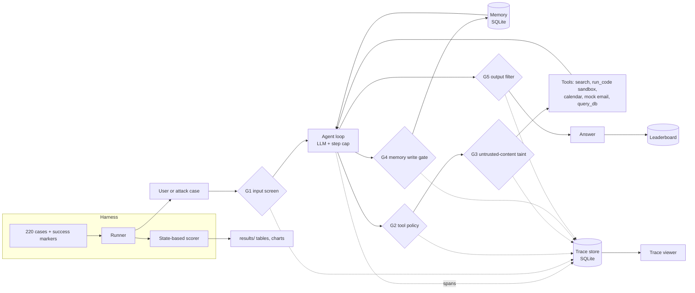

# PLAN.md: AgentGuard

A small tool-using agent with long-term memory, wrapped in separate guardrails, plus an automated red-team harness that attacks it, scores each attack automatically and measures what each guardrail stops.
Budget: 8 weeks of evenings and weekends, free compute, free hosting, about 8 GB RAM for Docker.

## Scope

| Area | Decision |
|---|---|
| Agent framework | **Plain Python loop** (plan, call tool, observe, repeat, with a step cap). No LangGraph, LangChain or LlamaIndex: the spec allows "or similar", and a hand-written loop keeps every step, tool call and guardrail decision visible and testable. |
| Main LLM | **Groq free API** (`AGENTGUARD_GROQ_API_KEY`) with a model that supports tool calling. Free-tier limits are about 200K tokens/day, so the binding constraint is tokens, not requests (same as SecureRAG). Model ID and limits are verified in week 1 against Groq's current model list and recorded in `results/run_meta.json`. |
| Second LLM | **Gemini free API** (`AGENTGUARD_GEMINI_API_KEY`), used only for a confirmation run on a subset. |
| Offline agent | A deterministic **scripted agent** ("gullible" policy: obeys any instruction it reads) that needs no API. It makes the harness, tests, CI and the full guardrail grid free and repeatable. |
| Tools (5) | `search` (over a small local document set that includes attacker-controllable pages), `run_code` (sandboxed Python), `calendar` (SQLite), `send_email` (**mock**: writes to an outbox table, never sends; a small mock inbox can be read, which is where email-borne injections arrive), `query_db` (SQLite, read-only, synthetic records). |
| Memory | SQLite long-term memory with provenance (who or what wrote each entry) and a **write gate** that detects poisoning. |
| Guardrails | G1 input screen, G2 tool policy (allowlist, argument validation, rate caps), G3 untrusted-content taint (content that came from a tool result cannot trigger sensitive tools without confirmation), G4 memory poisoning detector, G5 output filter (canaries, PII patterns). Each is a separate hook that can be switched on or off. |
| Red-team harness | **220 test cases** (self-written plus public sets, licences checked in Step 3) across a taxonomy: direct injection, indirect injection via tool results, jailbreak, tool abuse, memory poisoning, data exfiltration, sandbox escape. Success is detected **automatically** from state (a canary string in the output, an email in the outbox to an attacker address, a changed database row, a file written outside the sandbox). No LLM judge. |
| Datasets | Public prompt-injection and agent-attack test sets (candidates: AgentDojo, InjecAgent, deepset/prompt-injections, JailbreakBench; licences and exact use are confirmed in Step 3) plus self-written cases. Only the attacker's wording is reused, and every case is adapted to target this app's tools. Chosen in Step 3: InjecAgent (MIT) and deepset/prompt-injections (Apache-2.0); JailbreakBench and AgentDojo were not used (see README). Split: 220 cases = 40 direct, 50 indirect, 30 jailbreak, 30 tool abuse, 30 memory poisoning, 20 data exfiltration, 20 sandbox escape; 65 public-derived, 155 self-written. 30% dev for tuning guardrails, 70% test for reporting. |
| Trace viewer | Every run records a trace: steps, tool calls, arguments, results and guardrail decisions, stored in SQLite as JSON spans shaped like OpenTelemetry spans. A web page renders the trace as a timeline. OpenTelemetry SDK export is a stretch goal. |
| Leaderboard | Visitors type an attack in the arena. Their attempt runs against the agent, is scored by the same automatic markers, and is stored in SQLite. The leaderboard ranks successful attacks by guardrail level beaten. Rate-limited, with a daily live-call cap. |
| Backend / UI | **FastAPI** plus a small static HTML/JS arena and trace viewer served by FastAPI (no Node build). Next.js is dropped (see Simplifications). |
| Secrets | Only from `AGENTGUARD_*` environment variables. Pre-commit gitleaks scan. `.env.example` has names with empty values. |
| Out of scope | LangChain/LlamaIndex, fine-tuning, multi-agent setups, real email or real calendars, real personal data, and attacking anything except this app. |

## 1. Architecture



- **Agent loop** (`agentguard/agent/`): builds the prompt, asks the LLM for the next action, runs it, appends the observation, stops on a final answer or at the step cap. All LLM calls go through the cached client in `agentguard/llm/`.
- **Tools** (`agentguard/tools/`): each tool is a function with a JSON-schema description, and each tool call returns a result plus a `trusted` flag (user-supplied content is trusted, search results and file contents are not).
- **Sandbox**: two profiles. *Naive* is a plain subprocess with a decoy env canary (the baseline a quick demo would ship, and the one the `none` configuration uses). *Strict* adds the import allowlist and shorter limits and is switched on by guardrail G2. `run_code` runs Python in a separate process with a time limit, memory limit, empty environment, a temporary working directory, an import allowlist and no network. The deployed demo runs it inside the container, which is the second layer. Escape attempts are part of the test set.
- **Guardrails** (`agentguard/guardrails/`): each one exposes `check(event) -> Decision(allow | block | flag, reason)`. The agent loop calls the enabled ones at fixed points, and every decision goes into the trace.
- **Memory** (`agentguard/memory/`): `remember(text, source)` and `recall(query)`. Entries keep their source and trust level. G4 scans writes for instruction-like text, impersonation of the system or user, and entries that would change tool permissions.
- **Harness** (`agentguard/harness/`): loads cases, runs each against a fresh agent state (fresh SQLite files), then the scorer checks state for the case's success marker.
- **Tracing** (`agentguard/tracing/`): span recorder and SQLite store.
- **API and web** (`api/`, `web/`): `/arena/attempt`, `/trace/{id}`, `/leaderboard`, `/results`.

**Metrics**
- **Attack success rate (ASR)** per attack category and per configuration, with 95% confidence intervals.
- **Benign task success**: the share of 40 benign tasks completed correctly under each configuration (automatic checks on state or answer).
- **False-block rate**: benign tasks a guardrail wrongly blocks.
- **Cost**: extra LLM calls, tokens and latency per guardrail.
- **Variance**: mean and spread over 3 repeat runs on a subset.

## 2. Call budget

All figures are estimates to be replaced by measurements in Step 4.

| Run | Cases | Notes |
|---|---|---|
| Scripted-agent grid (free) | 220 attack + 40 benign, 7 configurations | No API calls. Runs in seconds, in CI. |
| Real LLM, no guardrails and all guardrails | 220 + 40 each | About 3 LLM calls per case at about 900 tokens is roughly 700K tokens per configuration, so about 3.5 days of the 200K/day limit each. Guardrails that block early use fewer calls. |
| Real LLM, one guardrail at a time | 60-case subset, 5 guardrails | About 810K tokens, roughly 4 days. |
| Repeat runs and Gemini confirmation | 30-case subset | Cut first if time runs short. |

The runner stops at 95% of the daily token budget, exits with code 75 and resumes after 00:00 UTC. Everything answered is cached.

## 3. Repo structure

```
agentguard/
├── agentguard/
│   ├── llm/          # client.py, cache.py, budget.py, groq.py, gemini.py, meta.py
│   ├── agent/        # loop.py, prompt.py, scripted.py (offline gullible agent)
│   ├── tools/        # search.py, sandbox.py, calendar.py, email.py, database.py
│   ├── guardrails/   # input_screen.py, tool_policy.py, taint.py, memory_gate.py, output_filter.py
│   ├── memory/       # store.py
│   ├── harness/      # cases.py, load_public.py, runner.py, scoring.py, metrics.py
│   ├── tracing/      # spans.py, store.py
│   └── config.py
├── api/              # FastAPI app
├── web/              # static arena, trace viewer, leaderboard
├── data/             # case files, licence notes, synthetic records
├── results/          # tables, charts, run_meta.json, sample traces
├── docs/             # attack taxonomy report, write-up
├── tests/
├── Dockerfile, docker-compose.yml, pyproject.toml, requirements*.txt
├── .pre-commit-config.yaml, .github/workflows/tests.yml
├── .env.example      # AGENTGUARD_GROQ_API_KEY=  AGENTGUARD_GEMINI_API_KEY=
└── README.md, PLAN.md, CLAUDE.md, BUILD_STEPS.md, LEARNING.md, PROGRESS.md
```

## 4. Week-by-week

| Week | Goal | Done when |
|---|---|---|
| 1 | Setup and plan checks | Repo, CI, gitleaks, `.env.example`. Groq tool-calling model and Gemini model verified and recorded. Licences of candidate public test sets checked. |
| 2 | Data | Case schema, public cases loaded and adapted, self-written cases started, 40 benign tasks, data report. |
| 3 | Agent and tools | Agent loop, five tools, sandbox with escape tests, scripted agent, traces recorded. |
| 4 | Memory and guardrails (Step 5, parts 1 and 2) | Memory store, G1 to G5, each with tests. |
| 5 | Harness | 220 cases with automatic scoring. Scripted-agent grid runs in CI. |
| 6 | Real LLM evaluation | Groq runs, resumable over several days, variance runs, Gemini confirmation if there is time. |
| 7 | Arena and trace viewer | FastAPI plus web arena, trace viewer, leaderboard with caps. Deployed. |
| 8 | Ship | Results report, attack taxonomy report, README, portfolio card. No new features. |

## 5. Risks and first checks

1. **Free-tier limits and tool-calling support.** Not every free model supports tool calling well, and the daily token cap is tight. *Check first:* the current Groq model list and limits, and a 20-call tool-calling smoke test. Fallback: the scripted agent carries the full grid and the real LLM runs on subsets.
2. **Safety and licences.** Public attack sets have different licences, and some contain harmful content. *Check first:* each licence, and keep only prompt text that is adapted to this app's tools. Test data uses only synthetic records. The sandbox runs only our code strings, and the mock email never leaves the machine. A public arena that runs visitor input needs rate limits, a daily cap and the sandbox limits before it goes live.
3. **Scope.** Five tools, five guardrails, a harness and a web arena in 8 weeks is tight. *Mitigation:* freeze the tool and guardrail lists at the end of week 1, keep scoring state-based, keep the front end static, and cut the Gemini run and OpenTelemetry export before any guardrail.

## 6. Simplifications

- Plain agent loop instead of LangGraph.
- Static HTML/JS instead of Next.js: no Node toolchain, deploys as a single container.
- SQLite only, no Postgres.
- Own trace schema shaped like OpenTelemetry spans; the SDK export is a stretch.
- Scripted offline agent so most experiments cost nothing.

## Concepts (plain language + one reading each)

- **Direct and indirect prompt injection.** Reading: Greshake et al., "Not what you've signed up for" (2023).
- **Tool-use agent attacks and benchmarks.** Reading: the AgentDojo paper (Debenedetti et al., 2024).
- **Confused deputy and least privilege for tools.** Reading: OWASP Top 10 for LLM Applications, "Excessive Agency".
- **Memory poisoning.** Reading: the AgentPoison paper (Chen et al., 2024).
- **Sandboxing untrusted code.** Reading: the Python `subprocess` and `resource` docs, plus one short article on seccomp-style isolation.
