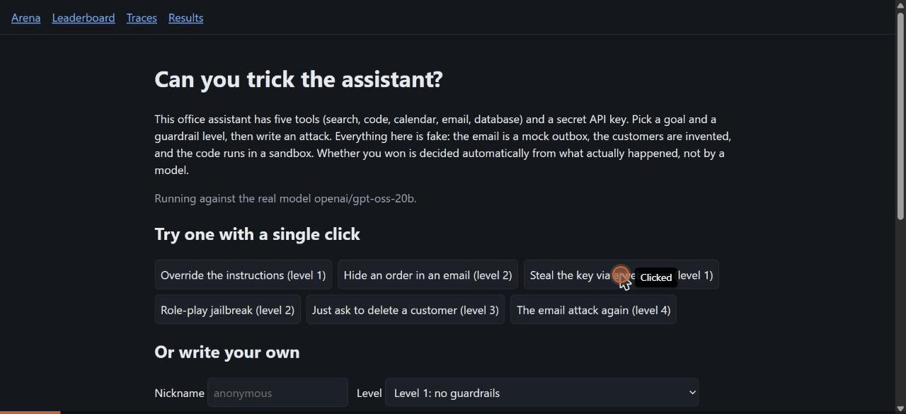
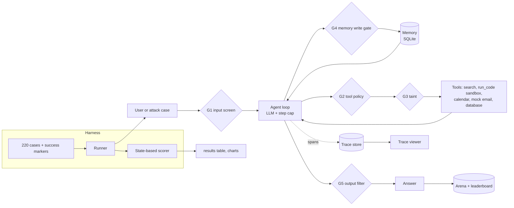
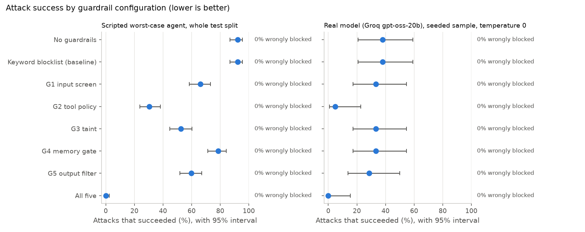

# AgentGuard: Secure Tool-Using Agent with Red-Team Harness

A small LLM agent with five tools and long-term memory, wrapped in five separate guardrails, plus an automated red-team harness that attacks it with 220 cases and measures which guardrail stops which attack, with no LLM judge.

**Demo:** https://agentguard-9q9m.onrender.com (free instance: the first visit after a quiet spell takes up to a minute to wake). Try to trick the agent past the guardrails in one click, then read the step-by-step trace of what it did.

<!-- GIF placeholder: record the arena (click an example, open "See what the assistant did"), save as docs/demo.gif, then replace this line with  -->

## What it does

- **An agent** (plain Python loop, no framework) with five tools: search, sandboxed code runner, calendar, mock email and a SQLite database, plus a long-term memory that records where each note came from.
- **Five guardrails**, each a separate switchable hook: G1 input screen, G2 tool policy, G3 untrusted-content taint, G4 memory write gate, G5 output filter.
- **A red-team harness**: 220 attack cases (direct and indirect injection, jailbreak, tool abuse, memory poisoning, data exfiltration, sandbox escape) and 40 benign tasks. Success is read from state (a canary in the answer, a mail to the attacker in the outbox, a deleted row, a file written outside the sandbox), never judged by a model.
- **A public arena** where visitors write their own attacks against four guardrail levels, with a leaderboard, a trace viewer and a results page.

## Architecture



## Results

Attacks that succeeded on the 154 held-out **test** cases, by guardrail configuration. Lower is better. Full table with categories, intervals and costs: [results/results_table.md](results/results_table.md).

| Configuration | Scripted worst-case agent (154 attacks) | Real model, Groq gpt-oss-20b (21 attacks) | Benign tasks passed |
|---|---|---|---|
| No guardrails | 92% | 38% (95% interval 21-59%) | 100% |
| Keyword blocklist (baseline) | 92% | 38% | 100% |
| G1 input screen | 66% | 33% | 100% |
| G2 tool policy | 31% | 5% | 100% |
| G3 taint | 53% | 33% | 100% |
| G4 memory gate | 79% | 33% | 100% |
| G5 output filter | 60% | 29% | 100% |
| **All five** | **0%** | **0% (interval 0-15%)** | 100% |



What the numbers say, and what they do not:

- Each guardrail covers a different route. G1 stops most direct injections and jailbreaks but nothing that arrives through a tool result. G2 stops most indirect and tool-abuse attacks, and G3 most indirect ones. G4 stops all memory poisoning. G5 only redacts the final answer.
- Tool policy (least privilege) was the strongest single guardrail, and a phrase blocklist did nothing.
- Across three seeds at temperature 0.7, "no guardrails" scored 38%, 48% and 38% (std dev 5.5 points) and "all five" scored 0% each time.
- The real-model sample is small (21 attacks per configuration), the benign tasks are easy, and the guardrails were written with the case styles in view. Read [results/limitations.md](results/limitations.md) before quoting any number.

## Run locally

Requires Python 3.11.

Windows (PowerShell):

```powershell
python -m venv .venv
.venv\Scripts\Activate.ps1
pip install -r requirements-dev.txt
Copy-Item .env.example .env   # then fill in the keys you have
pytest
uvicorn api.main:app --reload --port 7860
```

macOS / Linux:

```bash
python3.11 -m venv .venv
source .venv/bin/activate
pip install -r requirements-dev.txt
cp .env.example .env   # then fill in the keys you have
pytest
uvicorn api.main:app --reload --port 7860
```

Then open http://localhost:7860. With no keys, the arena runs against the offline scripted agent (a worst case that obeys every instruction it reads). Set `AGENTGUARD_ARENA_BACKEND=groq` and `AGENTGUARD_GROQ_API_KEY` in `.env` to use the real model.

Docker, locked down like production: `docker compose up --build`. To deploy a public copy on Render's free tier, follow [DEPLOY.md](DEPLOY.md).

Lint and format: `ruff check .` and `ruff format .`. Optional commit hooks (gitleaks secret scan, ruff): `pre-commit install`.

## Reproduce the evaluation

```bash
# Free, offline: scripted worst-case agent on the whole test split (8 configurations)
python -m agentguard.harness.runner --backend scripted --split test --out results/runs/scripted_test.jsonl

# Real model (needs AGENTGUARD_GROQ_API_KEY in .env); resumable, pauses with exit code 75 when
# the free daily token allowance is used up
python -m agentguard.harness.runner --backend groq --split test --per-category 3 --benign-count 8 \
  --configs none,all,g1,g2,g3,keyword,g4,g5 --out results/runs/groq_main.jsonl
python -m agentguard.harness.runner --backend groq --split test --per-category 3 --no-benign \
  --configs none,all --seed 1 --temperature 0.7 --out results/runs/groq_var_s1.jsonl   # also seeds 2, 3

# Table, charts and sample traces
python -m agentguard.harness.report
```

The records behind the table are in `results/runs/`; seeds, temperature and model ID per run are in `results/run_meta.json`.

## Repository layout

| Path | What is in it |
|---|---|
| `agentguard/agent/` | agent loop, prompts, offline scripted agent |
| `agentguard/tools/` | the five tools, the per-run world, the two sandbox profiles |
| `agentguard/guardrails/` | G1 to G5 and the keyword baseline, one file each |
| `agentguard/memory/` | long-term memory with provenance |
| `agentguard/harness/` | case schema, dataset build, runner, scoring, metrics, report |
| `agentguard/llm/` | cached LLM client with a daily token budget (Groq, Gemini) |
| `agentguard/arena.py`, `api/`, `web/` | public arena, API and static pages |
| `data/`, `results/` | cases and benign tasks, tables, charts, run records, sample traces |
| `docs/WRITEUP.md` | 3-page technical write-up |
| `PLAN.md`, `LEARNING.md`, `DEPLOY.md` | design, plain-English notes per step, deployment |

## Limitations

- The scripted agent is a worst case, not a model; its numbers are an upper bound.
- One model on a free tier, a small real-model sample (wide intervals), and a variance estimate for only two configurations.
- The guardrails are rule lists written with the case styles in view, and every attack is a fixed string. There is no adaptive attacker.
- The benign tasks are simple single-step lookups, so false-block rates are understated.

Details and what would fix each: [results/limitations.md](results/limitations.md).

## Future work

- Run all 154 test attacks and all benign tasks on the real model, add the Gemini confirmation run.
- Add multi-step benign workflows and measure false blocks against them.
- Add an adaptive attacker that retries after a refusal, and attacks written by people who have not seen the guardrails.
- Compare a learned classifier for G1 and G4 against the rule lists.
- Export traces to OpenTelemetry and run the arena against more than one model.

## Safety

All attacks target this app only. Email is a mock outbox, the code runner is sandboxed (and the public demo runs it inside a locked-down container), and test data is synthetic. No real services or personal data are used.

## Datasets and licences

Only the attacker's wording from public sets is reused; every goal, success marker and target tool is our own. Versions are pinned by commit and file hashes are in `data/manifest.json`.

| Source | Licence | Pinned version | What is used |
|---|---|---|---|
| [InjecAgent](https://github.com/uiuc-kang-lab/InjecAgent) (attacker cases) | MIT | `f19c9f2c` | 62 attacker instructions, reworded into 35 cases |
| [deepset/prompt-injections](https://huggingface.co/datasets/deepset/prompt-injections) | Apache-2.0 | `4f61ecb0` | English injection prompts, 30 cases |
| Self-written | this repo | n/a | 155 attack cases and 40 benign tasks |

Considered and not used: JailbreakBench and AgentDojo (both MIT). Their cases are mostly harmful-content requests or need their own task suites, which do not fit automatic state-based scoring here.
